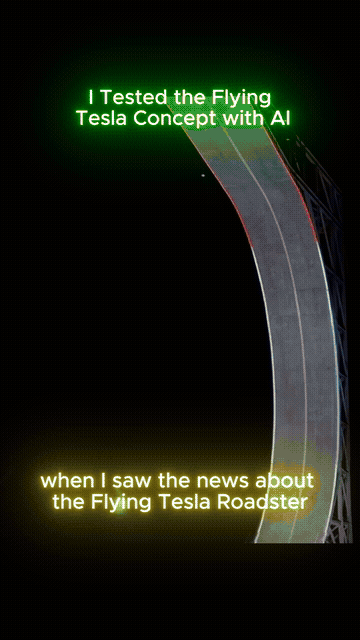
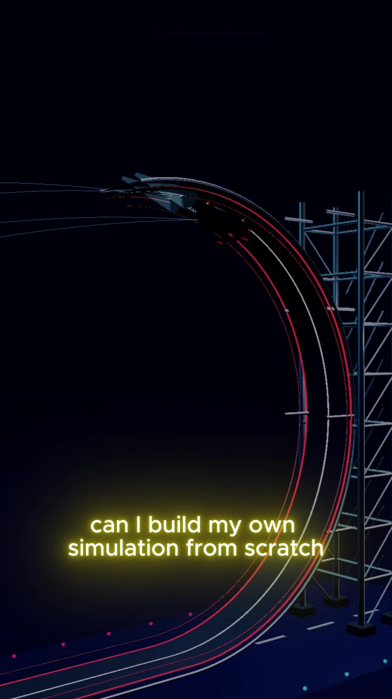
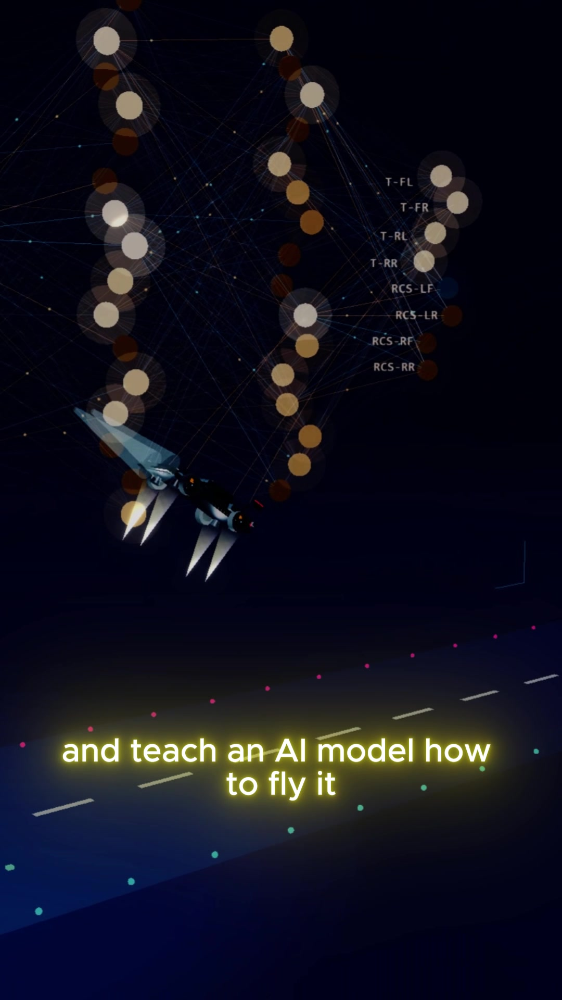
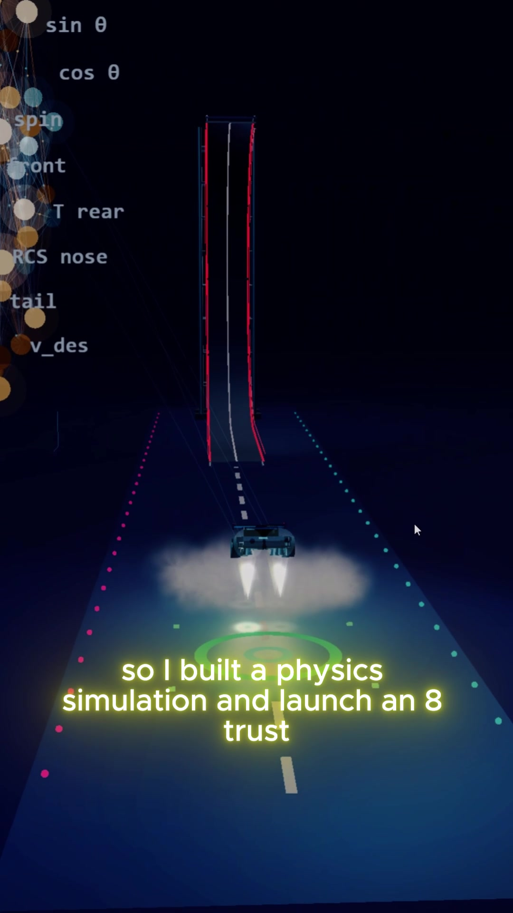

# 🚀 120Hz Autonomous Rocket Vehicle ("Flying Tesla") Landing Simulator

<p align="center">
  
  <br>
  <em>100% Real-Time Inference (SAC + DAgger) & 120Hz Newton Dynamics in WebGL</em>
</p>

<p align="center">
  <a href="https://www.python.org/"></a>
  <a href="https://pytorch.org/"></a>
  <a href="https://threejs.org/"></a>
  <a href="https://gymnasium.farama.org/"></a>
  <a href="LICENSE"></a>
</p>

An end-to-end autonomous flight control and hoverslam landing simulation combining **Reinforcement Learning (SAC & DAgger)**, **Rigid-Body Aerospace Dynamics**, and **Client-Side 120 FPS WebGL Visualization**.

> [!IMPORTANT]
> **Zero Mock / Pre-baked Data Guarantee:** Every movement, thruster exhaust plume, and actuator output seen in the 3D viewport is computed live. The trained PyTorch neural network weights run directly in pure JavaScript via 120Hz matrix multiplication and Symplectic Euler physics.

---

## 📸 Simulation Showcase

| 1. Inverted C-Loop Launch | 2. 3D Neural Synapses & Retro-Burn | 3. Soft Touchdown & Ground Cushion |
| :---: | :---: | :---: |
|  |  |  |
| *Ramp acceleration up to 90 km/h* | *12-in $\to$ 8-out real-time inference* | *Target touchdown with $|v_z| \le 1.5$ m/s* |

---

## 🌟 Overview & Key Features

### 1. The Challenge (C-Loop Launch & Hoverslam)
A 1,800 kg rocket-assisted vehicle is accelerated up a $196^\circ$ C-Loop launch ramp and hurled inverted into the sky. The autonomous agent must:
1. **Attitude Recovery:** Recover from a $360^\circ$ mid-air barrel roll using cold-gas Reaction Control System (RCS) thrusters.
2. **Glideslope Tracking:** Align with the target landing pad located $45\text{ m}$ away.
3. **Hoverslam (Suicide Burn):** Fire retro-thrusters at the terminal second to achieve touchdown with vertical speed $|v_z| \le 1.5\text{ m/s}$ and pitch/roll $< 10^\circ$.

### 2. Multi-Actuator Control Configuration
* **4 Bottom Main Thrusters:** Independent retro-rockets ($TWR \approx 2.20$, up to $38.8\text{ kN}$ total thrust) with first-order actuator lag ($\tau = 0.08\text{ s}$).
* **4 Lateral Cold-Gas RCS Jets:** High-speed lateral attitude actuators ($F_R = 6.5\text{ kN}$, $\tau = 0.025\text{ s}$).

### 3. Realistic Aerospace Dynamics
* **Tsiolkovsky Propellant Depletion:** Real-time mass flow $\dot{m} = \frac{T}{I_{sp} \cdot g_0}$. The vehicle gets lighter as fuel burns; if the $45\text{ kg}$ propellant reservoir empties, engines cut out (flameout).
* **Plume Ground Effect Cushion:** Plume gas bouncing off the tarmac provides an exponential ground cushion at $h < 1.8\text{ m}$.
* **Aerodynamic Drag & Coulomb Contact:** Quadratic airspeed resistance and tire suspension spring-damper friction models.

### 4. Neural Network Architecture & Telemetry HUD
* **Continuous State Space (12-D):** Relative target error, altitude, horizontal & vertical velocities, orientation ($\sin/\cos$ pitch & roll), angular rates, target velocity profile, and total thrust normalization.
* **Continuous Action Space (8-D):** $[-1, 1]^8 \to$ 4 main thrusters + 4 RCS jets.
* **3D Live Synapse Visualizer:** Renders real-time layer activations and synaptic weights directly inside the Three.js viewport (`policy_net_3d.js`).

---

## 🧠 Reinforcement Learning Pipeline

```
  [ Human / Handcrafted Expert ] 
                 │
                 ▼
       [ DAgger Recovery ] ──┐
                 │           │
                 ▼           ▼
       [ Soft Actor-Critic (SAC) Training ]
       (Max Entropy Exploration in PyTorch)
                 │
                 ▼
    [ Weight Serialization: trained_policy.json ]
                 │
                 ▼
   [ 120Hz Client-side Forward Pass in Three.js ]
```

* **Soft Actor-Critic (SAC):** Off-policy maximum-entropy actor-critic formulation. Maximizing both expected return and action entropy prevents policy collapse during chaotic inverted launch states.
* **DAgger (Dataset Aggregation):** Collects out-of-distribution states from random atmospheric wind gusts and rampa ejections to reinforce recovery maneuvers.

---

## 📐 Single Source of Truth Physics Architecture

To guarantee strict parity between Python training and JavaScript browser execution:

```
[ hover/sim/physics_config.json ]  <--- CANONICAL TRUTH
               │
       ┌───────┴────────────────────────┐
       ▼                                ▼
[ hover/sim/params.py ]    [ hover/web/js/physics_config.js ]
(Python Gym Env)            (Auto-generated JS Constants)
       │                                │
       ▼                                ▼
[ dynamics.py & env.py ]    [ hover/web/js/physics.js ]
```

Any modification to vehicle mass, gravity, thrust limits, or damping is made once in `physics_config.json` and synchronized via:
```bash
python hover/sim/export_physics_config.py
```

---

## ⚡ Quick Start

### 1. Run the Web Simulator
Launch a local HTTP server and open the 3D visualizer in your browser:
```bash
# Start local server on port 8080
python -m http.server 8080
```
Open in browser: **`http://localhost:8080/hover/web/index.html`**

### 2. Interactive Keyboard Controls
| Key | Action | Description |
| :---: | :--- | :--- |
| **`1`** | **Ramp Launch** | Accelerates vehicle along the C-Loop ramp and launches inverted. |
| **`2`** | **Inverted Drop** | Drops vehicle from $30\text{ m}$ upside down to test attitude recovery. |
| **`3`** | **Chaotic Fling** | Random high-altitude roll, pitch, and angular spin test. |
| **`4`** | **Wind Gust** | Applies a sudden lateral aerodynamic impulse. |
| **`C`** | **Cycle Camera** | Switches between Chase, Cinematic, Orthogonal, and Free Orbit views. |
| **`M`** | **Toggle Drawer** | Opens telemetry and environmental options menu. |
| **`V`** | **Video Mode** | Minimalist cinematic HUD mode for screen recording. |

### 3. Run Unit & Parity Tests
Verify that Python dynamics and JavaScript client physics produce identical trajectory states:
```bash
python -m unittest discover -s hover/tests
```

### 4. Benchmark Trained Policy
Evaluate the policy over Level 0, Level 1, and Level 2 chaos scenarios:
```bash
python hover/evaluate_trained_model.py
```

### 5. Re-train Policy
```bash
python hover/train.py
```

---

## 📁 Repository Structure

```
.
├── DEV_GUIDE.md               # Developer quick reference & cheat sheet
├── README.md                  # Project overview and documentation
├── hover/                     # Main Rocket Vehicle Autonomous Simulation
│   ├── sim/                   # Physics engine & Gymnasium environment
│   │   ├── physics_config.json      # Canonical physics parameters
│   │   ├── export_physics_config.py # Sync script to JS
│   │   ├── dynamics.py              # 120Hz symplectic rigid-body mechanics
│   │   ├── env.py                   # Gymnasium RL environment
│   │   ├── expert.py                # Reference controller
│   │   └── launch.py                # C-Loop ramp kinematics
│   ├── web/                   # Real-time WebGL Simulator
│   │   ├── index.html         # Three.js viewport & primary flight HUD
│   │   ├── js/
│   │   │   ├── app.js               # Main application loop
│   │   │   ├── physics.js           # 120Hz client-side Newton physics
│   │   │   ├── policy_net_3d.js     # Live 3D neural network visualizer
│   │   │   ├── aircraft_hud.js      # Primary Flight Display (PFD) HUD
│   │   │   └── flight_controller.js # Flight envelope protection
│   │   └── css/styles.css
│   ├── tests/                 # Automated test suite (Dynamics & JS Parity)
│   ├── train.py               # SAC training pipeline
│   ├── train_dagger.py        # DAgger recovery training
│   └── evaluate_trained_model.py
└── plate/                     # 2-DOF Ball & Plate SAC module
```

---

## 📜 License
Distributed under the MIT License. See `LICENSE` for details.
